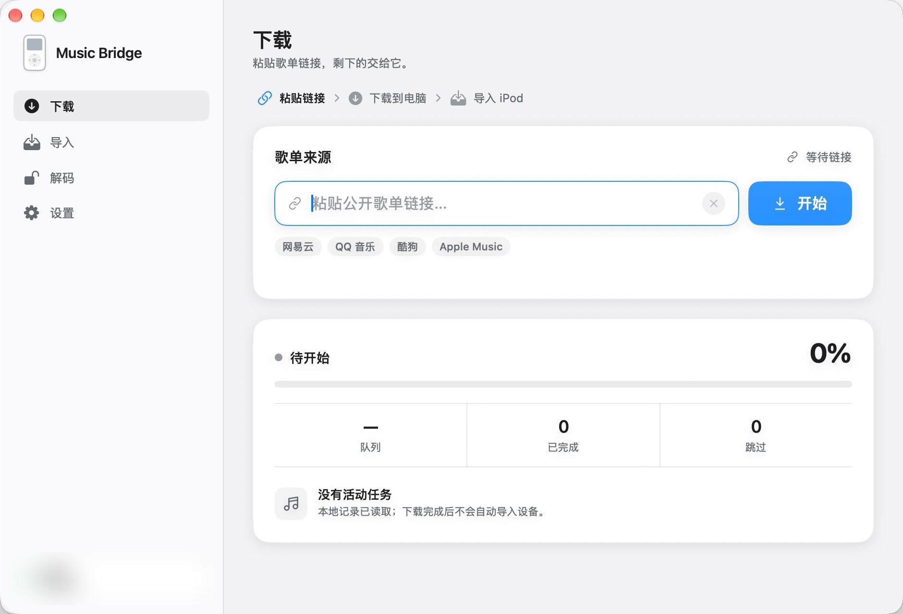
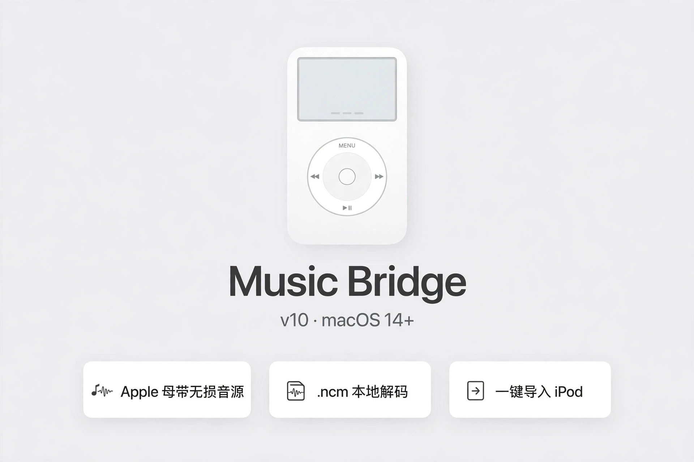
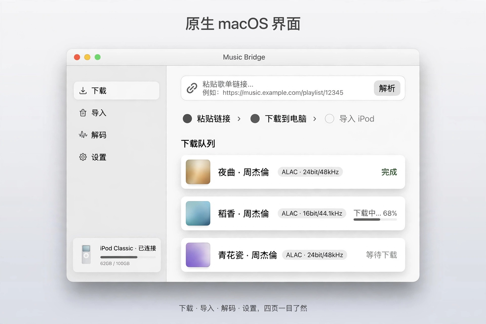
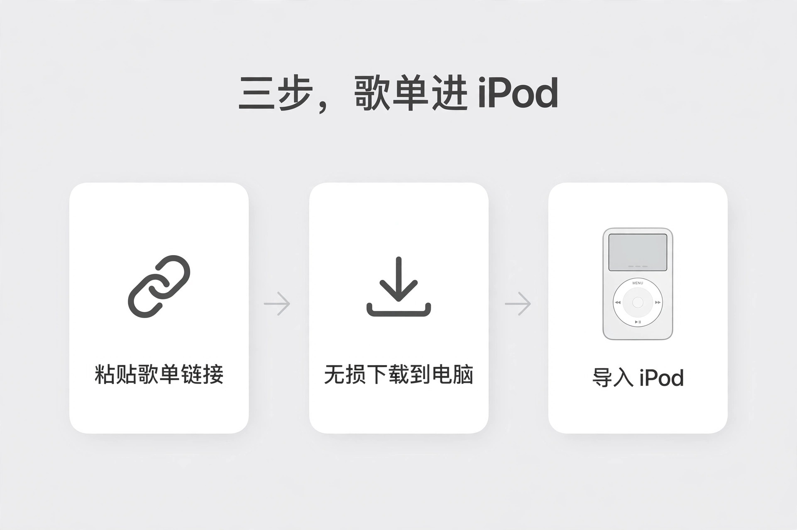

# Music Bridge

**Keep your playlists on your iPod.**

A native macOS app for migrating playlists from mainstream Chinese music players and manually importing music to Rockbox or stock-firmware iPods. Currently recognized public playlist links are limited to music.163.com and music.apple.com; other sources are not integrated yet.

English · [简体中文](README.zh-CN.md)

> Source beta. The app interface is currently in Simplified Chinese. Live playlist downloads and imports to a physical iPod have not yet completed end-to-end validation.



*Captured from the running app on Apple Silicon with macOS 27.2. This is the idle state with no device connected.*







## Features

- **Chinese-player playlist migration:** currently reads public music.163.com playlists and matches them to the Apple Music China catalog, or accepts Apple Music public playlists directly. Uncertain versions are skipped.
- **Local downloads:** calls your separately configured `amdl` and wrapper-lite service, with progress, cancellation and bounded logs.
- **Lossless quality settings:** choose an ALAC ceiling of 192 kHz or 48 kHz and save cover preferences between launches. Actual quality depends on the available source.
- **Manual iPod import:** reads mounted device details and enables import only for a writable, supported device. Downloads never trigger an automatic import.
- **Import modes:** Auto / Stock / Rockbox. Detection identifies available libraries, not the currently booted firmware. Auto defaults to Rockbox when both libraries exist; stock import remains selectable.
- **Playlists and artwork:** M3U8 keeps playlist order while import copies preserve original files and artist and album tags. Each track uses its own embedded artwork; a playlist cover is not applied to every song. Update or initialize the Rockbox database after ejecting; artwork display still requires device verification.
- **File protection:** checks paths, symbolic links and device identity, uses temporary copy files, and preserves existing files when their sizes differ. Same-path files with matching sizes are skipped.
- **Native desktop interface:** SwiftUI and AppKit, macOS window controls, opaque gray surfaces and short hover-border transitions. Device polling and task persistence run off the main thread. Respects Reduce Motion and Increase Contrast.

Ordinary USB storage is not identified as an iPod merely because it contains a .rockbox directory. Hardware evidence, library files, recorded models and default import settings are distinguished. Multiple devices require explicit selection; disconnecting one never redirects imports to another. Surface colors stay stable across desktop and window-focus changes; pointer-following lighting and 3D tilt have been removed.

## Build and run

You need macOS and Swift 6 or later with the macOS SDK. The package declares macOS 14 as its minimum; building and launching have been verified on Apple Silicon with macOS 27.2. Older supported systems have not been tested.

From the repository root:

If project records are waiting for macOS file access, use **选择项目文件夹** in the app and select the current project directory. The window stays responsive; pending reads are not treated as empty or completed records.

```sh
bash script/build_and_run.sh --verify
```

The script creates and opens `dist/MusicBridgeApp.app`. Building the interface does not require a download service. The app is not Developer ID signed or notarized, and this repository does not provide an installer.

## Configure downloads

Install and configure the external [amdl downloader](https://github.com/zhaarey/apple-music-downloader) and [wrapper-lite service](https://github.com/WorldObservationLog/wrapper/tree/lite) using their upstream instructions. The app expects these paths relative to the project root:

| Path | Purpose |
| --- | --- |
| `amdl` | Downloader executable |
| `config.yaml` | Your downloader configuration |
| `work/wrapper-lite-macos/start-local.sh` | Local wrapper launcher |
| `work/wrapper-lite-macos/` | Wrapper and QEMU runtime files |

The local wrapper endpoint is `http://127.0.0.1:12340`. A valid login, a ready service and an accessible playlist are required. Audio inspection also requires `ffprobe` (available with FFmpeg).

Keep the app in `dist/` relative to the project root so it can find these dependencies. Rebuild after moving the project. Authentication disks, personal configuration, downloaded music, logs and build artifacts are excluded from version control.

## Import to an iPod

1. Connect a mounted, writable iPod.
2. Download music using your configured local tools.
3. Choose **自动 / 原生 / Rockbox** (Auto / Stock / Rockbox). Review Rockbox files and audio specifications before importing; playlist playback and artwork require device verification.
4. Stock import previews counts before **备份并导入原生音乐库** (Back up and import). Safely eject afterward and check playback in the stock music menu.

### Stock import engine

Install the separate [podkit 0.6.0](https://github.com/jvgomg/podkit/releases/tag/podkit%400.6.0) runtime locally:

```sh
bash script/install_native_engine.sh
```

FFmpeg is required. Only engine version 0.6.0 is accepted. When the native database is missing, the app offers initialization after explicit model confirmation, backs up device information under `work/native-initializations/`, and reads the actual hardware identifier from the current volume's USB chain. Existing databases and orphaned native media block initialization. It never restores or formats the device. iPod touch and iPhone are unsupported; generations and storage modifications still require hardware validation.

This first stock path is additive only: plans containing removals, updates or upgrades are rejected. No delete, force-update or artwork-hash comparison flags are passed. Before writing, the adapter backs up `iTunes`, `Artwork` and `Device` files to `work/native-imports/<task-id>/database-backup/`. It reopens the database afterward and checks the track count; failed runs preserve backups without automatic rollback.

Stock imports retain original album metadata and artwork, and maintain a same-name native playlist in source order across both import stages. System lists and same-name lists containing unrelated songs are not overwritten. Initialization and playlist operations use the engine's bundled Bun runtime and libgpod module, with no separate Node installation. The Rockbox playlist cover is not applied. Preview copies, backups and the latest task record remain under `work/native-imports/`. Cancelling the preview does not write to the iPod. The screenshots above show an earlier interface.

The task card shows compatible, imported, existing, pending conversion, unresolved, unmatched and failed counts, plus per-track specifications, reasons and source/copy locations. It verifies database counts, playlist order, and device file sizes, then offers safe ejection and explicit playback feedback. Computer-side checks and user-confirmed device playback remain separate. Apple's built-in On-The-Go temporary playlist entry is not removable as an ordinary playlist.

### Device knowledge and two-stage imports

Compatibility details show part-code evidence, firmware when available, USB family data associated with this volume and a versioned offline knowledge base. Initial identification covers Video 5/5.5 and Classic 2007/2008/2009; recognized nano 6 devices are explicitly unsupported by this writer. Capacity, USB IDs and the shared A1238 enclosure number cannot establish a Classic revision. Users can separately confirm an unknown model for the current session; conflicting evidence cannot be overridden.

The default stock target is **iPod classic 3G (2009), ALAC 16-bit / 44.1 or 48 kHz, mono or stereo**. Unknown identities use that planning default without fabricating a detected model; explicitly identified other models and conflicting evidence remain distinct. This is application configuration, not an Apple-published ALAC decoder maximum or a claim of hardware validation. Optional conversion retains 48 kHz for the 48/96/192 kHz family and 44.1 kHz for the 44.1/88.2/176.4 kHz family. Original files remain unchanged. Sources and limitations are visible in the app and [PRODUCT.md](PRODUCT.md).

The first stage copies compatible ALAC or locally converts supported FLAC/PCM to same-spec ALAC. Compatible pre-existing AAC/MP3 sources remain lossy and are copied unchanged. Any engine plan that requests re-encoding is rejected. Higher-resolution lossless tracks are deferred until the first stage finishes, then users choose which to convert or skip. Unknown bit depth, unreadable media and multichannel downmixes are not automatically converted.

Confirmed reduced-spec copies stay under `work/native-conversions/`. Resampling uses working soxr when available, otherwise SWR with a 64-tap filter; final 16-bit quantization uses TPDF dither. A post-resampling peak analysis applies minimal attenuation only when needed to prevent clipping, with the backend and attenuation recorded. Output specifications and full decoding are checked before import. Original downloads are preserved.

The app cannot import while the device is disconnected, read-only or has an unknown write state. It does not overwrite existing files whose sizes differ. Matching file sizes are a skip rule, not a content-identity check. A successful `ffprobe` inspection is not a guarantee of playback on every Rockbox device.

## Checks and current limits

```sh
bash script/check.sh
```

Checks also cover stock/dual-library detection, unsafe-plan rejection and partial failures. When the pinned engine is installed, a real CLI fixture in an ordinary temporary directory verifies copying, FLAC conversion, database readback and repeat import without touching a physical iPod. Otherwise that check is explicitly skipped.

The standalone Swift checks cover link validation, cancellation, download arguments, quality and cover preferences, import guards, path and symbolic-link containment, stale callbacks, process output and bounded pointer input. They use temporary files and injected service responses; they do not sign in, download music or write to a physical device.

The full download and physical-device import workflows still need end-to-end validation. External services may change, and source availability and catalog matching vary by region and release.

## Privacy and license

NetEase playlist names, ordered tracks and covers are retrieved from NetEase's public endpoints. Apple Music matching accesses Apple's public website and catalog endpoints. Login credentials and subscription access are managed through your external tools.

Only process music you have permission to access. Source is licensed under [MIT](LICENSE). Dependency, asset and trademark information is listed in [Third-party notices](THIRD_PARTY_NOTICES.md).
