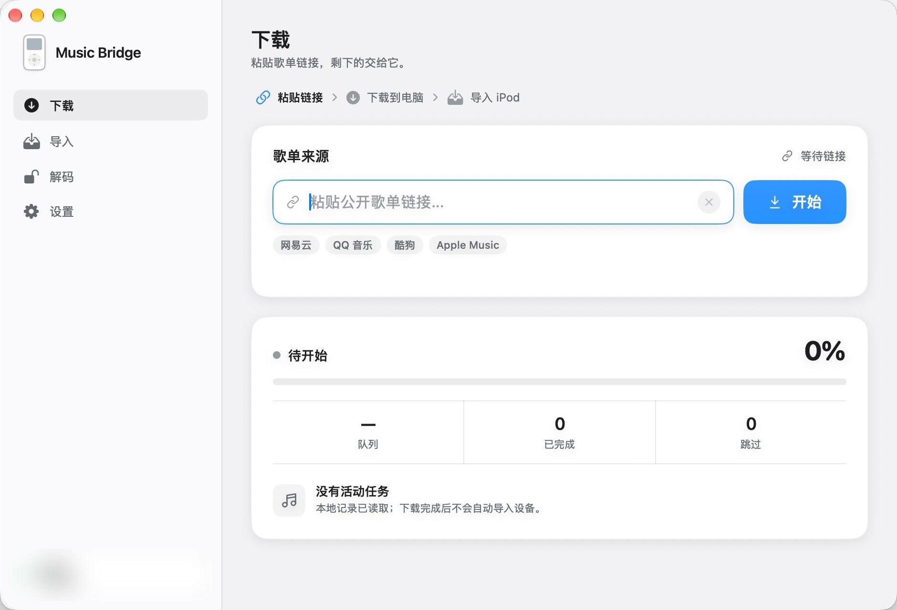
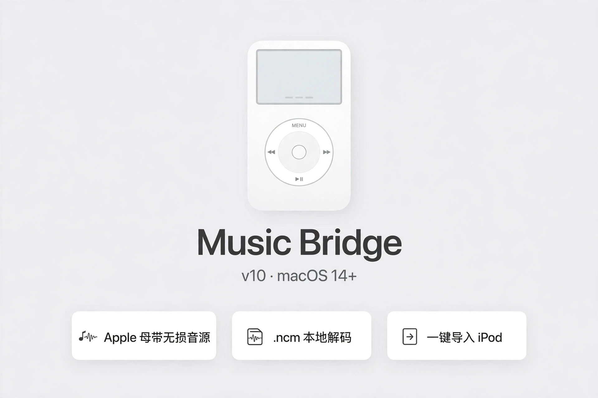
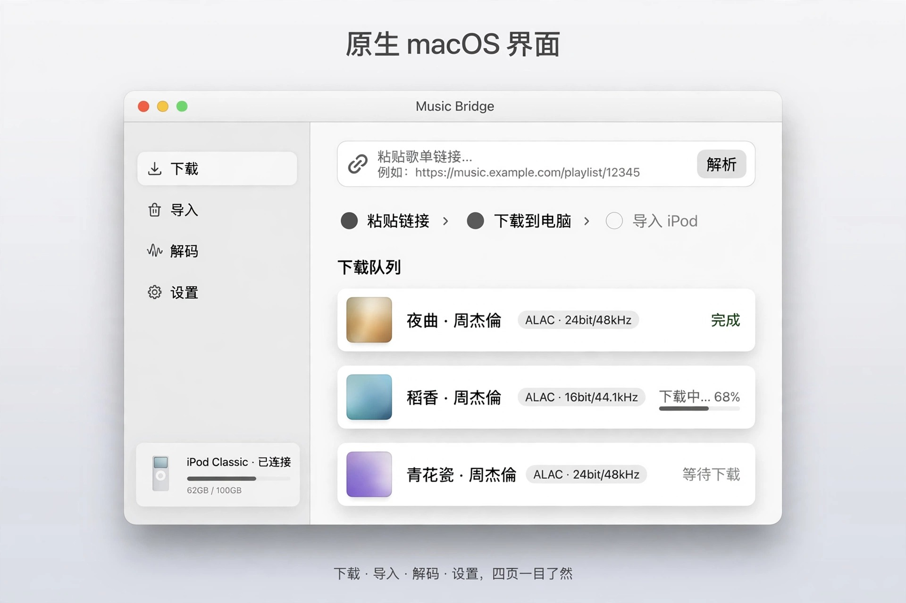
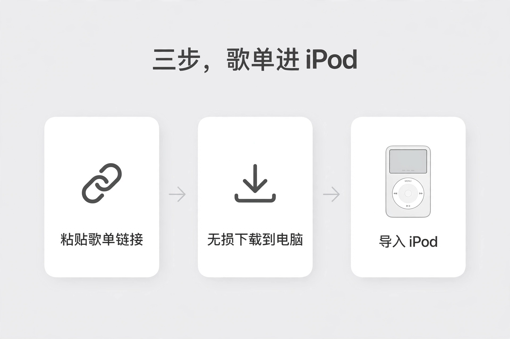

# Music Bridge

**让歌单继续留在你的 iPod 里。**

面向国内主流播放器歌单迁移与 iPod 手动导入的原生 macOS 应用。通过本地下载工具取得音乐，再选择 Rockbox 或苹果原生音乐库导入。当前可识别的公开歌单链接为 `music.163.com` 和 `music.apple.com`，其他来源尚未接入。

[English](README.md) · 简体中文

> 当前为源码测试版，软件界面使用简体中文。真实歌单下载与实体 iPod 导入尚未完成端到端验证。



*在 Apple Silicon、macOS 27.2 上从实际运行的应用采集。画面为未连接设备、没有活动任务的状态。*

## Apple 母带，一步到 iPod







**它是什么**

Music Bridge 是一款 macOS 应用，专门把流媒体上的歌单，送进 iPod Classic。

**音源**

歌单来自网易云、QQ 音乐、酷狗，音源走 Apple Music 母带无损。下载的是 ALAC，采样率封顶 48 kHz，正好是 iPod Classic 能完整解码的上限——下回来不用再转码，音质也不打折。

**流程**

粘贴歌单链接，剩下的三步：解析、下载、导入。歌单顺序、编号、同名封面都处理好，Rockbox 和原生系统都能导入。

**解码**

电脑里已经有的 .ncm 文件，可以直接在本地解码，标签和封面一起还原，照样导入 iPod。

**本地运行**

全程在你自己的 Mac 上完成，登录用你自己的账号，文件不经过第三方服务器。支持 macOS 14 及以上系统。

## 功能

- **国内播放器歌单迁移**：当前读取 `music.163.com` 公开歌单，并匹配到 Apple Music 中国区目录；也可直接使用 Apple Music 公开歌单链接。无法确认的版本会跳过。
- **本地下载**：调用单独配置的 `amdl` 和 wrapper-lite 服务，提供进度、取消及有长度上限的日志。
- **无损音质设置**：选择最高 192 kHz 或 48 kHz 的 ALAC 上限，并保存音质和封面偏好。实际质量取决于可用音源。
- **手动导入 iPod**：读取真实挂载设备信息，仅允许向可写且受支持的设备导入。下载完成后不会自动复制到设备。
- **两种导入方式**：检测 Rockbox 与原生音乐库，提供“自动 / 原生 / Rockbox”选择。双系统文件并存时自动选择 Rockbox，也可手动切换；不能据此判断设备当前启动了哪个系统。
- **保留歌单与专辑信息**：国内播放器歌单使用 M3U8 保存歌曲顺序，导入副本保留原文件及歌手、专辑标签；每首歌单独使用自己的内嵌封面，不套用歌单封面。导入后需在 Rockbox 中更新或初始化数据库；实际显示需在设备上确认。
- **文件保护**：检查路径、符号链接与设备卷标识，使用临时文件完成复制；同路径的已有文件逐字节核对，一致时复用，不一致时保留原文件。
- **原生桌面界面**：SwiftUI 与 AppKit、macOS 红绿灯、固定灰色表面和短时悬停边框过渡。设备轮询与任务写盘在后台执行；响应“减少动态效果”和“增强对比度”。

普通 U 盘不因存在 `.rockbox` 目录就被当成 iPod。设备卡区分 USB 硬件证据、曲库文件、型号记录和默认导入配置，显示系统报告的权限与可用空间。多台设备需要明确选择；当前设备断开后不会自动切换到另一台。灰色表面不随桌面、窗口激活或系统透明效果改变；旧版鼠标跟随与 3D 浮动已移除。

## 构建与运行

需要 macOS、Swift 6 或更新版本及 macOS SDK。包声明的最低运行版本为 macOS 14，构建与启动已在 Apple Silicon、macOS 27.2 上验证；较旧系统尚未实测。

在仓库根目录执行：

首次读取项目记录若等待系统文件访问，可在应用中点击“选择项目文件夹”，仅选择当前项目目录。窗口会继续响应，不会把尚未读完的歌单记录当成空库或已完成任务。

```sh
bash script/build_and_run.sh --verify
```

脚本会生成并打开 `dist/MusicBridgeApp.app`。仅构建界面不需要下载服务。本版尚未进行 Developer ID 签名或公证，也未提供安装包。

## 配置下载环境

按照上游说明分别配置 [amdl 下载器](https://github.com/zhaarey/apple-music-downloader) 与 [wrapper-lite 服务](https://github.com/WorldObservationLog/wrapper/tree/lite)。以下路径均相对于项目根目录：

| 路径 | 用途 |
| --- | --- |
| `amdl` | 下载器可执行文件 |
| `config.yaml` | 个人下载器配置 |
| `work/wrapper-lite-macos/start-local.sh` | 本地 wrapper 启动脚本 |
| `work/wrapper-lite-macos/` | wrapper 与 QEMU 运行文件 |

本地 wrapper 地址为 `http://127.0.0.1:12340`。实际下载需要有效登录、本地服务就绪和可访问的歌单。音频检查还需要 `ffprobe`，可随 FFmpeg 安装。

应用应保留在项目根目录的 `dist/` 下，以便找到运行依赖。移动项目后重新构建。认证磁盘、个人配置、下载音乐、日志和构建产物均排除在版本管理之外。

## 导入 iPod

1. 连接已挂载且可写的 iPod。
2. 使用配置好的本地工具下载音乐。
3. 选择“自动 / 原生 / Rockbox”。Rockbox 导入先预览编码、规格、同名文件和空间，再由用户确认；设备端播放仍需验证。歌单歌曲全部复制或与已有文件逐字节核对一致后生成 M3U8；存在未匹配或冲突时不生成完整歌单，变化的歌单另存新版本，保留旧歌单。
4. 原生导入先显示新增、已有、转码和未匹配数量；点击“备份并导入原生音乐库”后才写入。结束后安全弹出，在设备原生菜单检查播放。

### 原生导入引擎

原生导入通过独立的 [podkit 0.6.0](https://github.com/jvgomg/podkit/releases/tag/podkit%400.6.0) 进程执行。安装到本项目的 `work/`，不修改系统安装或全局 podkit 配置：

```sh
bash script/install_native_engine.sh
```

需要 FFmpeg；引擎版本固定为 0.6.0，其他版本会被拒绝。缺少原生数据库时提供“建立原生音乐库”：用户核对机型后，先备份设备信息，再使用当前设备的真实硬件标识创建空曲库。已有数据库或没有数据库的原生媒体文件会阻止初始化。设备信息备份位于 `work/native-initializations/`。不恢复或格式化设备，不支持 iPod touch / iPhone；具体代数及改装设备仍需实机验证。

首版原生导入只允许新增歌曲。预览计划包含删除、更新或升级已有歌曲时会停止；不传入删除、强制更新或封面哈希比较参数。写入前备份 `iTunes`、`Artwork`、`Device` 下的文件到 `work/native-imports/<任务编号>/database-backup/`，写入后重新读取数据库核对歌曲总数。失败时保留备份，不自动覆盖回滚。

原生导入保留原专辑标签与原有嵌入封面，自动维护同名原生播放列表，按源歌单顺序补齐首轮及转换阶段的歌曲。同名系统列表或包含其他歌曲的列表不会被覆盖。初始化和播放列表通过引擎自带的 Bun 运行环境及 libgpod 模块操作，无需另装 Node；不套用 Rockbox 歌单封面。预览副本、曲库备份及最近一次任务记录位于 `work/native-imports/`；取消预览不会写入设备。上方截图为此前版本，导入选项以当前构建为准。

任务卡统一显示总数、首轮兼容、新增、已有、待转换、无法确认、未匹配及转换失败数量，可展开每首规格、原因和原文件/副本位置。写入后核对数据库、播放列表顺序及设备文件大小。可安全弹出并记录“播放正常”或具体问题；电脑端核对与用户实机确认分别显示。On-The-Go 是苹果原生固件的临时歌单入口，不能像普通列表一样移除。

### 机型知识库与两阶段无损策略

“兼容详情”显示 SysInfo/SysInfoExtended 型号证据、可读取的固件、沿当前卷关联的 USB 家族信息和知识库版本。首批识别覆盖 Video 5/5.5、Classic 2007/2008/2009；nano 6 识别后明确提示原生数据库未适配。USB、容量及 A1238 外壳型号均不能单独确认 Classic 具体版本。未知型号可在详情中由用户补充，单独标记为用户确认并仅保留于本次会话；冲突信息不能通过手选覆盖。

默认原生目标为 **iPod classic 3G（2009），ALAC 16bit / 44.1 或 48kHz、单/双声道**，不再统一限制到 44.1kHz。无法识别具体型号时也按此默认目标规划，但实际检测字段保持未知；明确识别为其他型号或存在冲突时不会伪装成 Classic 3G。此为软件导入配置，Apple 官方资料未列出独立 ALAC 音频位深/采样率上限，未宣称已完成实机验证。高规格的 48/96/192kHz 系列可选转为 48kHz，44.1/88.2/176.4kHz 系列可选转为 44.1kHz；原文件保留。依据与边界见详情及 [PRODUCT.md](PRODUCT.md)。

首轮直接复制兼容 ALAC，或将兼容规格 FLAC/PCM 转成同规格 ALAC；原本有损但兼容的 AAC/MP3 单列并原样复制。引擎若计划再次转码，停止写入，不静默回退 AAC。高规格无损文件留到首轮结束后集中选择“转换所选歌曲并继续导入”或“本次跳过”；未知位深、多声道和无法读取的文件不自动转换。

确认降低规格后，独立 ALAC 副本保存在 `work/native-conversions/`。只改变未覆盖的位深/采样率，不升频、不补位深、不自动下混。优先使用实际可用的 soxr，否则使用 SWR 64 抽头高质量重采样；最后 16 位量化使用 TPDF 抖动。重采样后检测峰值，必要时仅施加防削波衰减，并在结果日志注明重采样器与衰减。输出规格与完整解码检查通过后才进入导入队列。

设备断开、只读或写入权限不明时不能导入。同路径但内容不同的已有文件不会被覆盖；逐字节一致可复用并加入歌单。`ffprobe` 检查通过也不保证在每台 Rockbox 设备上都能播放。

当前 Rockbox 歌单顺序支持已保存的网易云歌单；Apple Music 公开链接的完整曲目顺序尚不能可靠取得，因此不会把整个下载目录当作该歌单导入。

## 检查与当前限制

```sh
bash script/check.sh
```

检查包含原生/双系统识别、导入计划拦截和失败结果识别。安装了固定版本引擎时，还会在普通临时目录中验证实际复制、FLAC 转码、数据库读回及重复导入；不写入实体 iPod。未安装引擎时会明确跳过该项。

独立 Swift 检查程序覆盖链接验证、任务取消、下载参数、音质与封面设置、导入门禁、路径与符号链接边界、旧回调、进程输出和鼠标输入边界。检查使用临时文件及注入的服务响应，不登录账号、不下载音乐，也不写入实体设备。

完整下载和实体设备导入流程仍待端到端验证。外部服务可能变化，音源可用性及匹配结果也会因地区和发行版本而不同。

## 隐私与许可

网易云歌单名称、歌曲顺序和封面通过网易云公开接口读取。Apple Music 匹配会访问 Apple 的公开网页与目录接口。登录凭据及订阅访问由外部工具管理。

请仅处理你有权访问的音乐。源码采用 [MIT 许可证](LICENSE)，依赖、素材及商标来源见 [第三方声明](THIRD_PARTY_NOTICES.md)。
